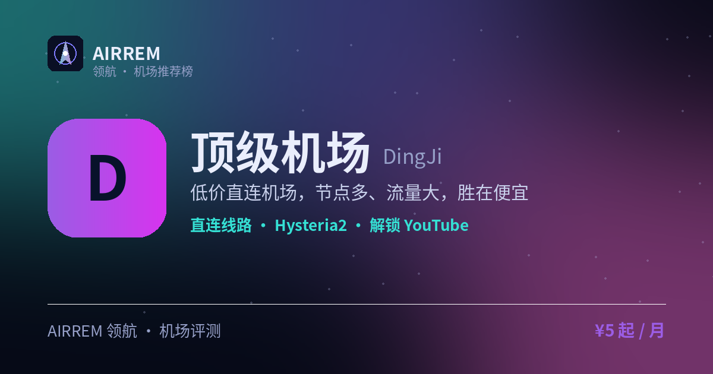

# 顶级机场评测 2026：价格敏感重流量，官网注册入口与套餐价格

> 低价直连机场，节点多、流量大，胜在便宜
>
> 最适合：**价格敏感重流量**。

👉 **[顶级机场 官网注册入口](https://s.rtxk.us/s/shk6g2s)** ｜ [完整评测与横向对比](https://555736.xyz/dingji/)

---

## 基本信息

| 项目 | 内容 |
| --- | --- |
| 机场名称 | 顶级机场（DJJC） |
| 成立时间 |  |
| 线路类型 | 公网直连 |
| 支持协议 | Hysteria2 / VLESS |
| 流媒体解锁 | YouTube / ChatGPT |
| 节点地区 | 美国 · 日本 · 香港 · 台湾 · 新加坡 · 韩国 等 |
| 计费方式 | 包月 / 按量 |
| 起步价格 | ¥5 / 月 |
| 推荐场景 | 想要低价大流量、能接受直连波动 |

## 优点与缺点

**✅ 优点**

- 价格低廉、节点与流量充足
- 覆盖地区较全，含部分冷门地区
- 适合大流量、低预算需求

**⚠️ 缺点**

- 直连受本地运营商影响，晚高峰不如专线稳
- 节点/IP 更新频繁，长期可用性不确定
- 机场行业存在跑路风险，建议先用月付或小额套餐验证稳定性，别一上来就大额年付。

## 顶级机场是什么

顶级机场（DJJC）主打低价与大流量，采用公网直连（非 IEPL/IPLC 专线），通过 Azure、AWS 等云入口接入，走「够用就好、价格优先」路线。

## 线路 · 协议 · 解锁

节点覆盖美日港台新韩等常见地区、也涉部分冷门地区，直连速度取决于本地运营商，节点/IP 更新较频繁；主要用 Hysteria2、VLESS，可满足 YouTube、ChatGPT，流媒体解锁通常弱于专线。

- 公网直连（Azure/AWS 入口）
- 协议：Hysteria2 / VLESS
- 节点/IP 更新较频繁

> 💡 不同运营商连同一直连节点体验差异明显，建议先小额实测。

## 顶级机场 套餐价格

| 套餐 | 价格 | 说明 |
| --- | --- | --- |
| 月付 | ¥5 | 1TB/月 |
| 不限时 | ¥8 | 200GB 用完为止 |
| 年付 | ¥12 | 200GB/月 |

> 直连线路，晚高峰/解锁可能不稳；价格取自公开评测，以官网为准。

## 常见问题

**Q：是专线机场吗？**

A：不是，采用公网直连（Azure/AWS 入口），价格更低但稳定性不及专线。

**Q：适合什么场景？**

A：适合价格敏感、日常娱乐大流量；稳定性要求高请选专线机场。

## 适合谁 / 不适合谁

| 👍 适合 | 👎 不适合 |
| --- | --- |
| 价格敏感、需要大流量 | 用于工作/直播/跨境电商等对稳定性要求高的用户 |
| 只做日常娱乐、能接受波动 |  |

## 我们的结论

走直连路线（Azure/AWS 入口），价格低、节点流量足，适合价格极敏感的大流量用户；速度受本地运营商影响大、节点 IP 更新频繁，不适合商务稳定场景。

## 同类机场推荐

拿不定主意？可以再看看这几家同类型的：

- **[Mitce](https://555736.xyz/mitce/)** — 性价比 / 新手主推，¥4 起
- **[良心云](https://555736.xyz/liangxin/)** — 低价尝鲜党，¥2 起
- **[一分机场](https://555736.xyz/yifen/)** — 低价大流量，¥2 起

全部 38 家机场的横向对比与选购方法论：**[信号塔 SignalTower · 机场大全](https://555736.xyz/airports/)**

---

数据更新：2026-07 ｜ 价格、套餐与优惠码以官网实时为准 ｜ 本仓库为第三方评测整理，与 顶级机场 官方无隶属关系 ｜ 请遵守当地法律法规使用网络服务。

关键词：顶级机场、dingji、DJJC、直连机场、低价机场、机场推荐
